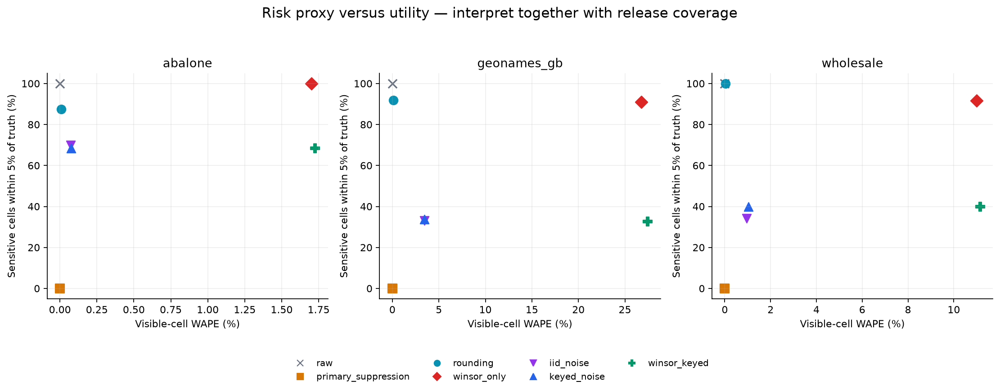

# TabularShield Lab

**How much statistical usefulness survives when we try to protect a table?**

An independent, reproducible Python research prototype for **magnitude-table disclosure control**: method comparisons, adversarial reconstruction, geographic diagnostics and a bounded API demonstration.

Public datasets only. No client data. No Cantabular, Queen's University or statistical-agency affiliation. **Research evidence, not a privacy-certified release system.** Built with AI coding support; see [scope and limitations](docs/limitations.md).



## Start here

- [Research report](reports/RESEARCH_REPORT.md) — results, negative controls and decisions.
- [Interactive report](reports/report.html) — download and open locally; standalone, no external scripts.
- [Methods and threat model](docs/methodology.md) — what is measured and what is not.
- [Learning and decision guide](docs/learning-guide.md) — reproduce, modify, explain.
- [Reconstruction evidence](reports/reconstruction.json) — attacker-visible linear constraints.
- [Data manifest](data/manifest.json) — citations, licences, transformations, SHA-256 hashes.

## What is implemented

| Research question | Implemented evidence |
|---|---|
| How do protection choices change totals? | Seven comparators across fixed workloads, 30 paired key seeds, seed-level 95% intervals |
| Can a hidden value be recovered from exact margins? | Linear-programming feasible intervals; primary versus greedy complementary suppression |
| Can repeated queries average away noise? | Matched-noise IID versus fixed-key averaging experiment |
| Do geographic errors cluster? | Real GeoNames GB settlement coordinates, symmetric great-circle kNN, Moran's I, permutation checks and neighbourhood sensitivity |
| Is the software maintainable? | Typed components, input checks, property tests, API integration tests, CI, pinned environment |
| Can a product call it? | Read-only FastAPI demo with fixed public datasets and fixed protection configuration |

There are three genuinely different public data sources: wholesale-customer spending, abalone measurements and reported settlement populations. The last two are **analogue evaluation domains**, not confidential human microdata. They test numerical behavior, not real-world re-identification probabilities.

## Reproduce

Python 3.12 or newer. The checked-in processed snapshots make evaluation offline after dependencies are installed.

```sh
python -m venv .venv
source .venv/bin/activate
python -m pip install -r requirements.lock
python -m pip install --no-deps --no-build-isolation -e .
export PYTHONPATH="$PWD/src"
tabularshield validate
pytest --cov=tabularshield --cov-report=term-missing
tabularshield evaluate --seeds 30
tabularshield report
```

The reference run uses Python 3.14; the lock records its environment. CI checks the supported 3.12 and 3.14 interpreters using declared dependency ranges. Seed-controlled numerical outputs should agree to the recorded precision; benchmark timings are machine-dependent. A [verification script](scripts/verify_reproduction.py) compares an independent rerun with the committed numerical output.

```sh
python scripts/verify_reproduction.py
uvicorn tabularshield.api:app --host 127.0.0.1 --port 8000
```

Visit `http://127.0.0.1:8000/docs`, or query:

```sh
curl -X POST http://127.0.0.1:8000/query \
  -H 'Content-Type: application/json' \
  -d '{"dataset":"wholesale","measure":"Fresh","group_by":["Region","Channel"]}'
```

The API returns perturbed sums only, with no exact counts, truth, contributor maxima or key material. It deliberately does not accept uploads, arbitrary SQL, user-selected seeds or unbounded filters. Fixed-key consistency alone **does not** solve composition or reconstruction across linked releases.

## Methods

`raw`, `primary_suppression`, `rounding`, `winsor_only`, `iid_noise`, `keyed_noise`, `winsor_keyed`.

The keyed magnitude prototype uses an illustrative symmetric lookup distribution and noise scaled to the largest contribution. It is **not** an implementation of official ONS/ABS production p-tables or a full replication of Cantabular. Winsorisation is an explicit ablation that may introduce bias. See the methods document before interpreting plots.

## Engineering and operations

- [Architecture and integration](docs/architecture.md)
- [Testing strategy](docs/testing.md)
- [Runbook](docs/runbook.md)
- [Project plan and acceptance criteria](docs/project-plan.md)
- [Contributing](CONTRIBUTING.md)

## Licence and attribution

Original project code: MIT. Data remain under their own CC BY 4.0 licences, with attribution in [DATA_SOURCES.md](data/DATA_SOURCES.md). Do not remove data attribution when reusing snapshots or outputs. No third-party implementation code has been copied.

Prepared by Ajay Sai Kummara with AI coding assistance. This repository records software and experimental outputs; it does not attest to independent mastery, employment experience or completed client delivery.

