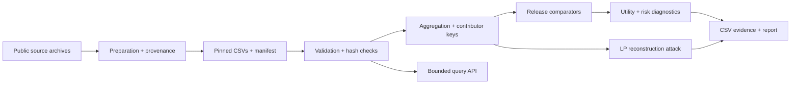

# Architecture and integration

`data.py` enforces the data contract. `core.py` separates statistical aggregation from release policy. `attacks.py` receives only what its stated attacker is assumed to observe. `spatial.py` evaluates geographic residuals. `experiment.py` executes the fixed workload; `report.py` reads recorded evidence to produce figures and a standalone report. `api.py` adapts the same release engine to HTTP.

## API boundary

The server only accesses three configured public datasets. An allowlist restricts measures and dimensions. Request schemas forbid extra fields, arbitrary filters and user-selected noise settings. Grouping order is canonicalized; identical requests have identical output. The response omits raw contributor values, counts, maxima, sensitivity flags and keys. This reduces accidental diagnostic leakage; it does not prove release confidentiality.

## Actual host-platform integration remains future work

Define the host's table-query and release contracts, map contributor units and survey weights, confirm the treatment of zeros and margins, and agree a version/key lifecycle with domain owners. Contract tests should compare approved reference outputs and simulate linked queries across table versions. This repository does not call or modify a live Cantabular service.

## Performance scope

Recorded timings measure local aggregation on actual snapshots. No production concurrency, distributed execution or national-scale latency claim is made. Repeated queries are not independently sampled observations. The API's dataset cache is bounded; dataset refresh requires restart and hash review. Memory grows with table cardinality and dense spatial pairwise distances; large spatial data need a tree index or sparse neighborhood representation.
